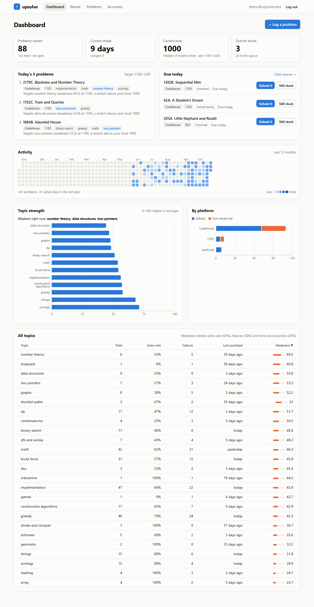
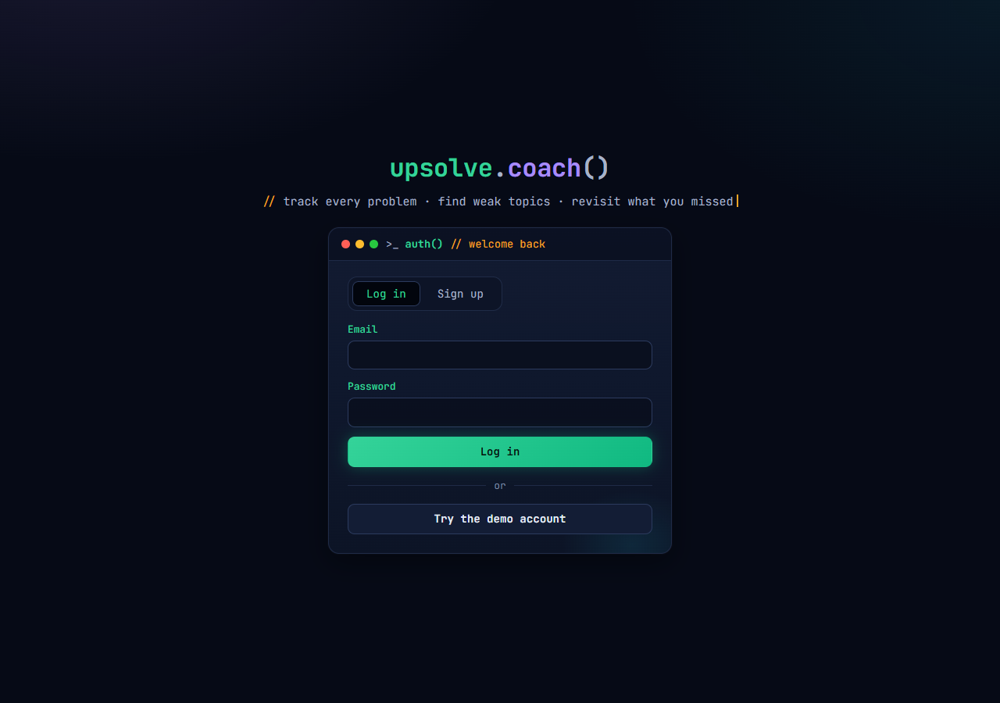
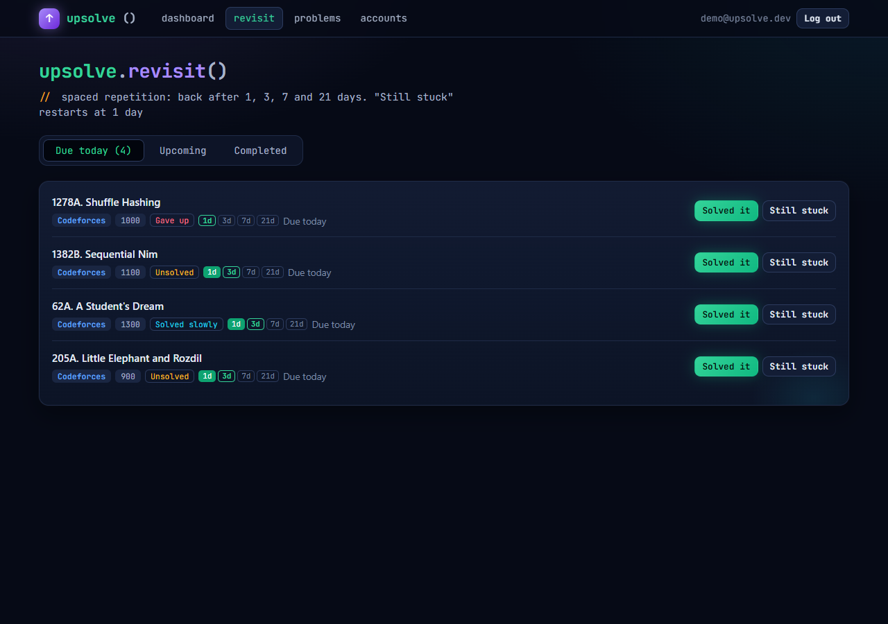
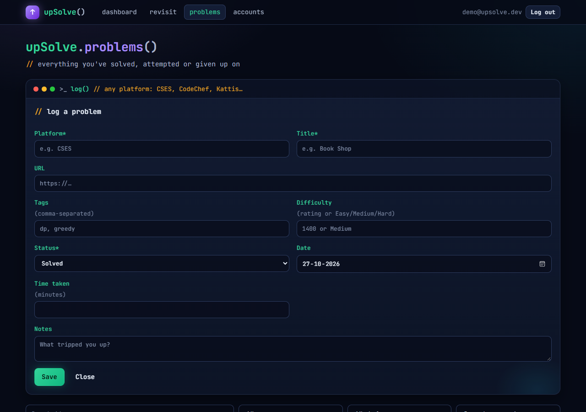
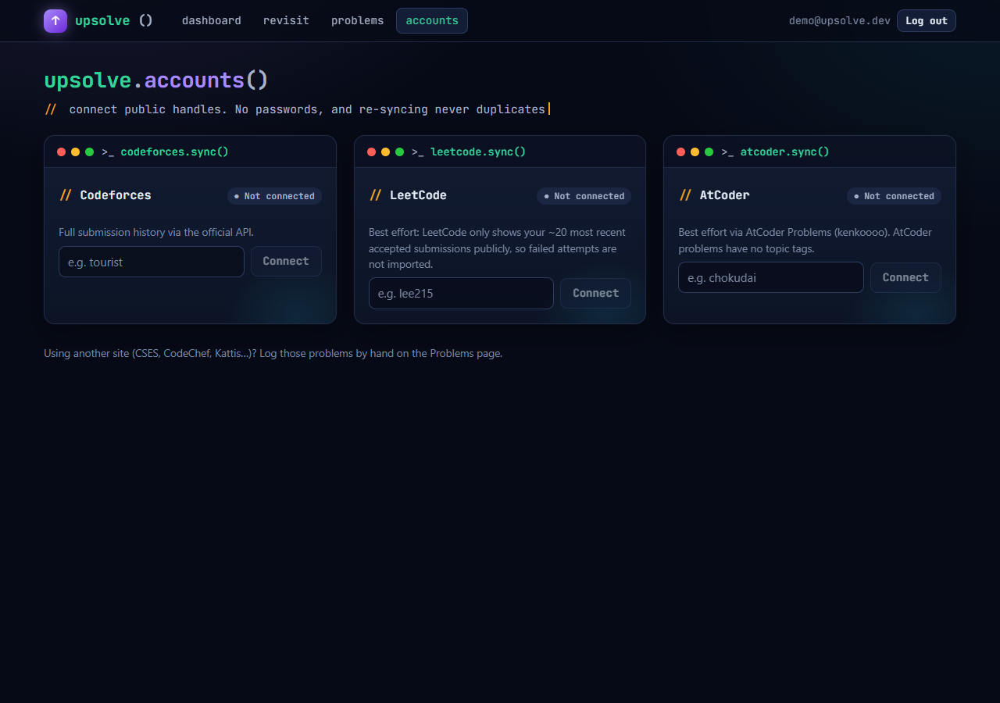

# upSolve

**Demo video:** [Watch on Google Drive](https://drive.google.com/file/d/1rKiNAlDhkxWnnDZ3Z0YnA4SKFZz8k_Oq/view?usp=sharing) · **Live app:** https://upsolve.onrender.com

A competitive programming coach. upSolve keeps track of every problem you've solved or attempted on
Codeforces, LeetCode, AtCoder and any other site you log by hand. From that history it:

- finds your **weak topics** with a weakness score per topic,
- **recommends 3 problems a day** aimed at those topics, a little above your current level,
- brings failed, abandoned and slowly solved problems **back for review** after 1, 3, 7 and 21 days.



| Login | Revisit queue | Log a problem | Accounts |
|---|---|---|---|
|  |  |  |  |

<!-- Screenshots show the seeded demo account. Replace with your own as the project evolves. -->

The UI uses a dark "terminal" theme: JetBrains Mono headings written like code (`upSolve.dashboard()`),
`// comment` labels, and window-style cards. Chart colours were checked for colour-blind
separation and contrast against the dark surface.

---

## Features

| Workflow | What it does |
|---|---|
| **Sync** | Connect public handles for Codeforces, LeetCode and AtCoder, then import solved and attempted problems. You can re-sync safely: it never creates duplicates. |
| **Manual entry** | Log a problem from any platform: platform, title, URL, tags, difficulty, status (solved / attempted / gave up), date, time taken and notes. If you paste a Codeforces, LeetCode or AtCoder URL, the entry is linked to the same problem the sync uses. |
| **Analyze** | Per-topic stats (problems tried, solve rate, failures, last practised, weakness score). The dashboard shows topic strength, solved vs. unsolved per platform, a 12-month activity heatmap, and your current and longest streak. |
| **Recommend** | 3 problems per day aimed at weak topics, rated 100–200 points above your current level. Problems you've already solved or attempted are never recommended. The picks stay the same for the whole day. |
| **Revisit** | Problems you attempted, gave up on, or solved slowly come back after 1 → 3 → 7 → 21 days. "Solved it" moves a problem to the next interval. "Still stuck" restarts it at 1 day. |

## Quick start (no database needed)

Requires **Node.js 20+**.

```bash
npm run install:all          # installs server/ and client/
cp server/.env.example server/.env
npm run dev:server           # API on http://localhost:4000 (in-memory MongoDB + demo data)
npm run dev:client           # in a second terminal: UI on http://localhost:5173
```

Open http://localhost:5173 and click **Try the demo account** (`demo@upsolve.dev` / `demo1234`).

The default `.env` uses `MONGO_URI=memory`, which starts a throwaway in-memory MongoDB. The first run
downloads a MongoDB binary of about 100 MB. Data resets when the server restarts, and
`SEED_ON_START=true` recreates the demo user every time.

### With a real MongoDB

Set `MONGO_URI` in `server/.env` to a local or Atlas connection string, then:

```bash
npm run seed                 # creates/refreshes the demo user (only touches that user's data)
npm run dev:server
```

## Environment variables

`server/.env` (see `server/.env.example`):

| Variable | Required | Description |
|---|---|---|
| `MONGO_URI` | yes in production | MongoDB connection string, or `memory` for an in-memory dev DB |
| `JWT_SECRET` | yes in production | Long random string (≥ 32 chars in production) used to sign login tokens |
| `JWT_EXPIRES_IN` | no | Token lifetime, default `7d` |
| `PORT` | no | API port, default `4000` |
| `CLIENT_ORIGIN` | no | Allowed CORS origin(s), comma-separated. Default `http://localhost:5173` |
| `NODE_ENV` | no | `development` / `production` / `test` |
| `SEED_ON_START` | no | `true` re-seeds the demo user on boot |

`client/.env` (optional): `VITE_API_URL` is needed only when the client is hosted on a different
domain from the API.

## Tests

```bash
npm test
```

This runs 51 tests with Node's built-in test runner:

- **Unit tests** (`server/test/lib.test.js`) for the pure logic: weakness score, target difficulty,
  recommendation picking, rating normalization, the review schedule, topic stats, streaks, the
  heatmap and timezone handling.
- **API tests** (`server/test/api.test.js`) against an in-memory MongoDB with fake platform
  adapters, so no network is needed. They cover auth, validation, manual entry, idempotent sync,
  graceful "LeetCode sync unavailable" handling, analytics, recommendations, reviews, and isolation
  between users.

## Architecture

```
upSolve/
├── server/                     Node.js + Express 5 + Mongoose
│   ├── src/
│   │   ├── app.js              Express app (routes, security middleware, error envelope)
│   │   ├── index.js            Boot: connect DB, optional seed, listen
│   │   ├── config/             env parsing, DB connection (MONGO_URI=memory support)
│   │   ├── middleware/         JWT auth, zod validation, error handler
│   │   ├── models/             User, PlatformAccount, Problem, Attempt, ReviewSchedule
│   │   ├── routes/             auth, attempts, accounts (+sync), analytics, recommendations, reviews
│   │   ├── services/
│   │   │   ├── adapters/       codeforces.js · leetcode.js · atcoder.js (same interface)
│   │   │   ├── sync.js         runs an adapter, upserts idempotently, schedules reviews
│   │   │   ├── catalog.js      shared problem catalog + daily Codeforces problemset refresh
│   │   │   ├── analytics.js    loads history → pure functions
│   │   │   ├── attempts.js     manual entry
│   │   │   └── reviews.js      spaced-repetition queue
│   │   ├── lib/                PURE functions (no DB/IO), unit-tested
│   │   │   ├── scoring.js      weakness score, target difficulty, daily picks
│   │   │   ├── analytics.js    topic stats, platform counts, heatmap, streaks
│   │   │   ├── reviewSchedule.js  1/3/7/21-day rules, "solved slowly" threshold
│   │   │   ├── difficulty.js   LeetCode/AtCoder → approximate rating
│   │   │   └── tags.js         cross-platform tag normalization ("Dynamic Programming" → dp)
│   │   └── utils/              HTTP client (throttle, retry with backoff), TTL cache, ApiError
│   ├── scripts/seed.js         demo user with ~5 months of realistic history
│   └── test/
└── client/                     React 19 + Vite + Recharts
    └── src/
        ├── pages/              Dashboard, Revisit, Problems, Accounts, Login
        └── components/         TopicChart, PlatformChart, Heatmap, TopicTable, ReviewItem, AddProblemForm
```

### Data model

- **Problem**: a catalog shared by all users, unique on `(platform, externalId)`, with normalized
  `tags` and `rating`.
- **Attempt**: `source: synced | manual`. A synced attempt is one aggregated document per
  `(user, problem)`, upserted on every sync, which is what makes sync idempotent. Each manual entry
  is its own event.
- **ReviewSchedule**: one per `(user, problem)`, with `stage` (index into 1/3/7/21), `dueAt`,
  `status` and `history`.
- **PlatformAccount**: one per `(user, platform)`, with the handle, sync status and the last
  error and stats.

### Platform adapters

Each adapter has the same interface: `validateHandle`, `verifyHandle`, `fetchActivity` and an
optional `fetchCatalog`. Each returns problems and attempts in one normalized format. Outbound
requests go through `utils/http.js`, which adds:

- a minimum gap between requests to the same host (2.1 s for Codeforces, 1.1 s for kenkoooo),
- timeouts,
- exponential backoff with jitter on network errors, 429 and 5xx responses.

Responses are cached in a TTL cache. Concurrent sync clicks are blocked by an atomic lock on the
account.

| Platform | Source | Notes |
|---|---|---|
| Codeforces | Official API: `user.status`, `user.info`, `problemset.problems` | Full history, including wrong submissions. The problemset (~11k problems with tags and ratings) is the recommendation pool and refreshes at most once a day. |
| LeetCode | Unofficial public GraphQL (`recentAcSubmissionList`, `question`) | **Best effort.** Public data only, with no password or cookies. Only the ~20 most recent accepted submissions are visible, so only recent solves are imported. Failures show "LeetCode sync unavailable". |
| AtCoder | kenkoooo AtCoder Problems API | **Best effort.** Full submission history, paged 500 at a time. Difficulty comes from kenkoooo's estimates. AtCoder problems have no topic tags. |

### The formulas

All three live in [`server/src/lib/scoring.js`](server/src/lib/scoring.js), with a plain-English
comment above each one:

- **Weakness** (0–100) = 100 × (0.5 × (1 − smoothed solve rate) + 0.3 × failures/(failures + 3)
  + 0.2 × min(days since practice / 30, 1)), where smoothed solve rate = (solved + 1)/(tried + 2).
- **Target difficulty** = median rating of your last 30 rated solves (default 1000), plus 100 to 200.
  LeetCode Easy, Medium and Hard count as 1200, 1600 and 2000.
- **Daily picks**: candidates in the target window (widened if there are too few) are scored as
  70% weakness of their weakest topic and 30% closeness to the target. A seeded random nudge per
  user and day breaks ties. Picks prefer distinct focus topics.
- **Solved slowly**: time taken above 30 min + 5 min per 100 rating above 800, capped at 150 min.

### API

Every response uses the same envelope: `{ ok: true, data }` or
`{ ok: false, error: { code, message, details? } }`.

| Method | Path | Purpose |
|---|---|---|
| POST | `/api/auth/register` · `/api/auth/login` | email + password → JWT |
| GET | `/api/auth/me` | current user |
| GET/POST | `/api/attempts` | list (filters: status, platform, source, q, page) / manual entry |
| PATCH/DELETE | `/api/attempts/:id` | edit / delete a manual entry |
| GET/POST | `/api/accounts` | list / connect a handle |
| POST | `/api/accounts/:id/sync` | import from the platform |
| DELETE | `/api/accounts/:id` | disconnect (removes that platform's synced attempts) |
| GET | `/api/analytics/summary?tz=` | totals, topics, platforms, heatmap, streak, level |
| GET | `/api/recommendations/today?tz=` | today's 3 problems |
| GET | `/api/reviews?scope=due\|upcoming\|completed&tz=` | revisit queue |
| POST | `/api/reviews/:id/result` | `{ result: "solved" \| "failed" }` |

`tz` is the user's offset from UTC in minutes, so that "today" means the user's local day.

### Security

- Passwords are hashed with bcrypt (cost 12). JWTs are sent as Bearer tokens.
- Login and register are rate-limited (30 requests per 15 minutes per IP). Login doesn't reveal
  whether an email exists.
- `helmet`, CORS restricted to `CLIENT_ORIGIN`, a 100 kb JSON body limit, and zod validation on
  every input.
- Every query is scoped to the logged-in user.

## Deployment

**One click on Render (free).** The repo includes a [`render.yaml`](render.yaml) blueprint:

[](https://render.com/deploy?repo=https://github.com/Akankshaa1502/upSolve)

By default it uses the built-in demo database (`MONGO_URI=memory`). The demo account always works,
but new sign-ups are lost whenever the free instance sleeps (after 15 idle minutes) or restarts. For
persistent data, set `MONGO_URI` to a MongoDB Atlas connection string in the Render dashboard.
The first request after the instance has slept takes about a minute while it boots.

**Option A: one service, any host.** On Render, Railway or Fly:

1. Build command: `npm run install:all && npm run build`
2. Start command: `npm start`
3. Environment: `NODE_ENV=production`, `MONGO_URI=<Atlas URI>`, `JWT_SECRET=<random 48+ chars>`

In production, Express serves `client/dist` with SPA fallback, so you only deploy one service.

**Option B: separate frontend.** Deploy `server/` as above with `CLIENT_ORIGIN=https://your-frontend`.
Deploy `client/` to Vercel or Netlify with build `npm run build`, output `dist`, and
`VITE_API_URL=https://your-api`. Add an SPA rewrite rule (`/* → /index.html`).

Notes:

- Use MongoDB Atlas (the free tier is enough). `MONGO_URI=memory` is for development only.
- Run `npm run seed` against the production DB if you want the demo account available.
- The caches are in-process. If you run more than one API instance, move the caches and sync lock
  to Redis.

## Known limitations

- LeetCode only exposes recent accepted submissions publicly, so older LeetCode history and failed
  LeetCode attempts must be logged manually.
- AtCoder problems carry no topic tags, so they count toward totals, the heatmap and level, but not
  toward topic weakness.
- Recommendations come from the Codeforces problemset (and any other tagged, rated problems in the
  catalog).
- Platform APIs don't expose how long you took on a problem, so "solved slowly" only applies to
  manual entries.
